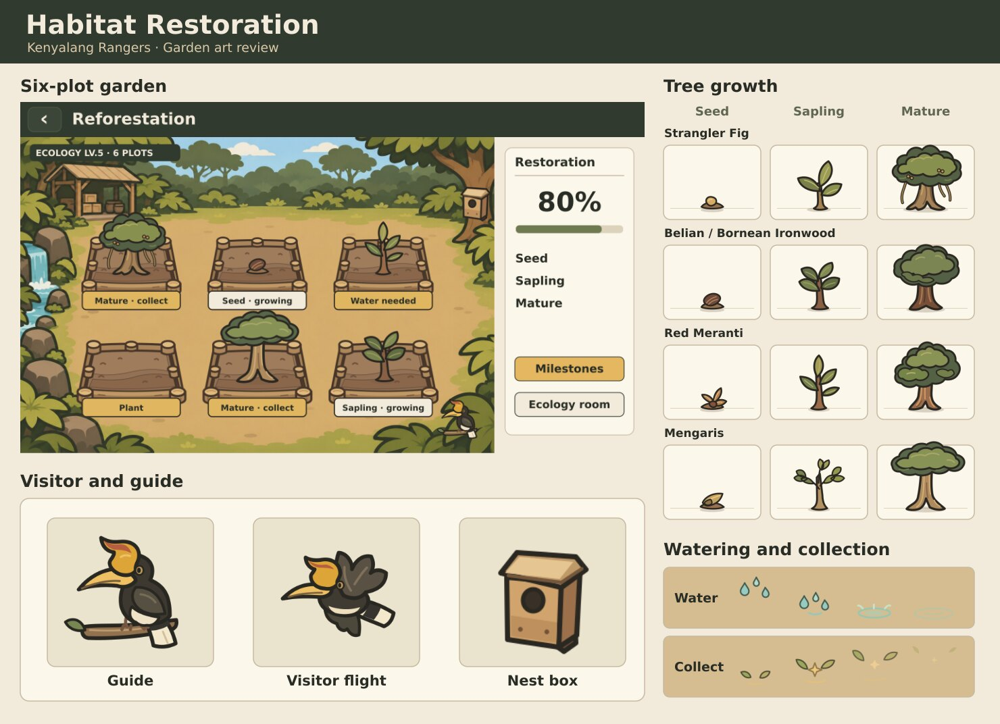

# W19b · Habitat Restoration art

**23 November 2026.** The kit has 12 tree sprites, a garden clearing, a reusable plot bed, a Rhinoceros Hornbill guide and visitor pose, a nest box, and two effects. The [art manifest](../../assets/source-art/restoration/manifest.json) maps each part to its source, texture, pivot and stable ID. [View the art review sheet](w19b/art_review.jpg)

## Trees and field notes

Each tree has exactly **Seed → Sapling → Mature**. Forms and scale distinguish the stages. The species table uses the GDD's in-game base durations. The illustrations simplify the species' shapes, and the timers represent game time. [GDD p. 27 § M.10 and Fig. 9](../canon/DATA_CONTRACTS.md#habitat-restoration) · [Storyboard pp. 89–92 S47–S50](../canon/ART_AND_UI_SPEC.md#storyboard-frame-index)

| Stable ID | Game base duration | Art cues | Field note and evidence |
|---|---:|---|---|
| `species.strangler_fig` | 18 hours | Rounded seed cue, broad sapling leaves, broad mature crown with hanging roots and orange figs. | `fact.strangler_fig_start`. Some strangler figs start on another tree's branches and send roots down to the ground. [NParks, *Ficus kerkhovenii* profile](https://www.nparks.gov.sg/florafaunaweb/flora/4/1/4185) · [Rain Forest worksheet, Strangling Fig entry](https://www.nparks.gov.sg/-/media/nparks-real-content/learning/learning-journeys/guided-walks/diy-guided-walks/botanic-gardens-rainforest/worksheets-for-students.pdf) |
| `species.belian` | 36 hours | Furrowed oval seed, broad leathery leaves, dense crown and sturdy dark trunk. | `fact.belian_identity`. Belian is also called Bornean ironwood. Its scientific name is *Eusideroxylon zwageri*. [NParks, common names and Description and Ethnobotany](https://www.nparks.gov.sg/FloraFaunaWeb/Flora/2/8/2891) |
| `species.red_meranti` | 48 hours | Winged fruit cue in Seed, pointed sapling leaves and a tiered crown. | `fact.red_meranti_example`. Meranti tembaga is an example of a light red meranti that occurs naturally in Borneo. The scientific reference is listed as *Shorea leprosula* and *Rubroshorea leprosula*. [MyBIS, species account](https://www.mybis.gov.my/art/374) · [NParks, synonym and Fruit entry](https://www.nparks.gov.sg/florafaunaweb/flora/3/1/3124) |
| `species.mengaris` | 72 hours | Flat winged pod cue, small leaflets, high spreading canopy and a broad trunk base. | `fact.mengaris_identity`. Mengaris is one Sabah name for *Koompassia excelsa*. [MyBIS, common-name row](https://www.mybis.gov.my/sp/10185) · [NParks, Crown, Trunk, Foliage and Fruit entries](https://www.nparks.gov.sg/florafaunaweb/flora/2/9/2983) |

Use the healthy Seed or Sapling drawing while a plot waits for water. Growth pauses at the approved midpoint checkpoint and resumes on watering. Mature scenery stays visible after collection and the plot can be planted again. [GDD p. 27 § M.10](../canon/GAME_RULES.md#outreach-records-and-habitat-restoration) · [D-010](../canon/DECISION_LOG.md#approved-decisions) · [Storyboard pp. 91–92 S49–S50](../canon/ART_AND_UI_SPEC.md#storyboard-frame-index)

## Garden layout and visitor

| Part | C20 presentation |
|---|---|
| Clearing and beds | The 1,200 × 800 clearing separates the forest, hut and stream framing from the six bed sprites. The manifest's placement example keeps the six soil pivots stable in a 3 × 2 grid. At Ecology Lv.1, the first two slots are active. Use the same bed art under the level-specific lock overlay for later slots. Keep touch buttons and labels in the UI layer. [GDD pp. 19–20 § M.1 and p. 27 § M.10](../canon/DATA_CONTRACTS.md#habitat-restoration) · [Storyboard p. 89 S47 and p. 111 V09](../canon/ART_AND_UI_SPEC.md#storyboard-frame-index) |
| Hornbill guide | Use the perched pose at the lower right. The amber casque, long bill and cream tail with a dark band identify the stylised Rhinoceros Hornbill. The guide can point to `fact.hornbill_tree_cavity` and the species field notes. [GDD p. 27 § M.10](../canon/DATA_CONTRACTS.md#habitat-restoration) · [Forest Department Sarawak, Description and Habits](https://forestry.sarawak.gov.my/web/subpage/webpage_view/854) · [IUCN Hornbill Specialist Group, Identification and Habits](https://iucnhornbills.org/rhinoceros-hornbill/) |
| Nest-box discovery | At the fourth distinct mature collection, bring in the box at its tree mount and briefly move the flight pose into view. The visitor cue plays once and can reveal `fact.nest_box_habitat`. The field note explains that a box may add a potential nest site and suitable habitat still matters. [GDD p. 27 § M.10](../canon/DATA_CONTRACTS.md#habitat-restoration) · [D-010](../canon/DECISION_LOG.md#approved-decisions) · [Storyboard p. 93 S51](../canon/ART_AND_UI_SPEC.md#storyboard-frame-index) · [Sarawak Museum Journal, case-study abstract](https://museum.sarawak.gov.my/web/subpage/webpage_view/310) |
| Watering and collection | The shallow ripple and rising leaves are **art timing proposals**. Read the four 128 × 128 cells left to right, align the shared `(64, 96)` pivot to the soil anchor and play the strip once after the corresponding action completes. The leaf glint marks completion while the result UI shows Funds. [GDD p. 27 § M.10](../canon/GAME_RULES.md#outreach-records-and-habitat-restoration) · [Storyboard pp. 91–92 S49–S50](../canon/ART_AND_UI_SPEC.md#storyboard-frame-index) |

The [W18 reference register](w18/references.json) owns the draft fact copy and original source links. The kit binds to those IDs for C20. Player-facing copy follows the [C19 approved-bank intake](../../data/education/README.md). The artwork depicts a fictional garden. The sources cover broad species and habitat information and the player copy keeps active nest sites private.

## Export and import

- Open the [editable vector sources](../../assets/source-art/restoration/) to change art. Each tree sheet uses three adjacent 256 × 256 areas with a ground pivot of `(128, 224)` inside each area. Export the three areas in Seed, Sapling and Mature order as transparent RGBA PNGs. The perched and flying bird use two adjacent 256 × 256 areas in `hornbill.svg`. The manifest supplies each crop rectangle.
- The [runtime textures](../../assets/imported/restoration/) use landscape-friendly dimensions. Bind them by `restoration_art.*` and their `res://` paths. Align art first, then place actionable labels above it. Use linear filtering for the illustrated edges. The proposed board coordinates describe a 3:2 art area inside a landscape viewport and scale as one group. Preserve the separate Restoration panel and touch target bounds when adapting to a wider phone.
- Render the effects as horizontal 512 × 128 RGBA strips. The suggestions in the manifest are visual frame timings. At the end, hide the effect overlay. Retained mature art can sit on a scenery layer while a new Seed uses the interactive bed. The guide, nest box and flight pose each have their own pivot.
- The clearing is a flat 1,200 × 800 JPEG export from an original 1,536 × 1,024 generated illustration. Editable background layers are open. Inkscape exports the other assets from nine original vector sheets. The SVG sheets sit behind `.gdignore` and the runtime textures are importable.

## Provenance and validation

The clearing was generated for this project using the S47 storyboard and the W06 Scout Sniper v0.2.0 cutout sheet as visual references. The [manifest](../../assets/source-art/restoration/manifest.json) records the selected master hash and export dimensions. The remaining illustrations are original W19b vector paths. Linked botanical and conservation material supplies factual references. Project art review, named sign-offs and distribution clearance follow [D-014](../canon/DECISION_LOG.md#open-decisions).

Clearing illustration prompt

Create a new environment-only 2D game background for Kenyalang Rangers, an original Bornean rainforest conservation garden. The first image is the user's S47 storyboard, reference for the garden clearing, framing and colours only. The second is the approved game sprite reference, reference for the thick rounded almost-black outlines, compact rounded forms, deep olive greens, muted tan and restrained flat shadow patches only.

A wide landscape canvas, about 3:2, framing a warm ochre and olive garden clearing at a gently elevated front-facing angle. The upper strip shows layered broadleaf rainforest canopies, small pale blue sky breaks and a tiny timber shade shelter tucked against the upper left. At the far left edge a small waterfall and rounded mossy stones frame the foreground. Frame the right and lower corners very lightly with bold dark olive tropical leaves and one broad tree trunk on the far right edge. The centre opens into a very wide continuous FLAT blank matte warm ochre soil clearing. The clearing begins at about 24% of the image height. Keep the region from x=11% to x=94%, y=27% to y=89% nearly empty, calm and low-contrast so six separate game plot sprites can be overlaid in a neat 3-column by 2-row arrangement without covering landmarks. This negative space matters more than decorative detail. Forest canopies and sandy clearing stay in warm, muted, dusty ochre, olive, cream and dark umber. Hand-drawn 2D chibi game art, strong rounded charcoal contours on framing objects, two matte colour planes per form, broad lively shapes, gentle natural light, tight match to the supplied garden and Ranger graphic style. Keep the art legible on Android landscape.

Output only the continuous environment/background illustration. No visible plots, beds, fences or paths in the empty area. No nest box, birds, characters, species sprouts, objects to interact with, wording, text, symbols, UI panels, border, logo or watermark. Avoid high contrast, detailed texture and harsh shadows anywhere in the clearing.

Editor inspection covered the four stage sets, alpha edges, independent props and the two- and six-plot arrangements at 960 × 540. Godot 4.7.2 passed editor import and headless startup, loaded the 19 textures at their manifest dimensions and passed 1,680 existing checks across 22 runners. For the C20 phone pass, open the Garden from both entrances, check the two- and six-plot layouts in landscape, verify Water needed and Collect stay readable over all stages, then relaunch after the one-time visitor to check the retained art and saved discovery.
