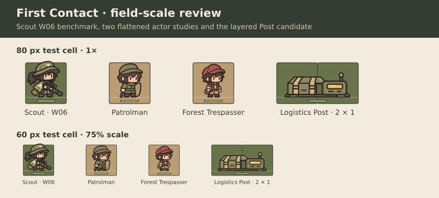

# W27-A0 · First Contact art review

**Status · approved as redraw direction, 23 November 2026.** The owner chose bare heads for the Trespasser and other enemies. This record shows the historical concept images. See the [study comparison](review/study_comparison.png), [cutout sheet](review/cutout_review.png) and [import acceptance](IMPORT_ACCEPTANCE.md) for the delivered parts. The [field-scale proof](review/field_scale.png) compares the reused W06 Scout with two new actor studies and one editable facility. The 80 px and 60 px cells are exact proof sizes over storyboard colors. The physical-phone and combat bindings are future acceptance checks. [Production plan](../W27_FIRST_CONTACT_ART.md) · [Rig contract](RIG_AND_IMPORT.md)

| Review file | What the owner can assess | What production still needs |
|---|---|---|
| [Patrolman study](review/actors/patrolman_study.png) | Silhouette with oversized mouthless face, short olive cap, narrow shield and simple baton. Olive garment and sand guard separate it from W06's long brim and equipment. | Check baton tip and shield width on the tile. Redraw into 17 independent layers with both grips and full hidden joints. Flatten the small interior tone variations to the approved W06 palette. Approve the visual height and independent facing proof. |
| [Forest Trespasser study](review/actors/e01_study.png) | Mouthless bark/rust outfit, pouch and a small basic-enemy read at the edge of the lane. | At smaller scale its hat/hair outline is close to the Ranger figures. Owner-approved revision removes the cap. The finished 15-part kit is bare-headed and uses the original study pixels outside the hair patch. Test recognition in gray, then review the walk and block states and enemy Intel crop. |
| [Logistics Post Ready proof](review/logistics_post/ready_preview.png) | Low crate and radio, compressed enough to sit inside two raised cells. The amber panel is a visual point for existing Token cues. | Test the silhouette on actual legal pairs and at a phone angle. Draw a dedicated thumbnail and complete the ghost, ordinary scaffold, Token pulse and loss treatment. |
| [Post SVG](review/logistics_post/logistics_post.svg) and [manifest](review/logistics_post/manifest.json) | Editable base, supply crate, radio/antenna and Ready indicator. Individual transparent exports share the same exact coordinates. | Review branch-only assembly. Final imported path, rendering order and approved cue socket will be signed off with the visual binding. |

## Source and import evidence

- Both actor studies are original generated concept images directed by the owner’s lineup and the W06 neutral Scout. True alpha is present. Both are flattened and contain faint stray alpha outside the visible silhouette, so use them to guide the independent redraw. The recorded bounds at alpha ≥16 approximate the visible bodies for the review plate. The plate's foot positions are illustrative art registration, with no measured skeletal joints. [Source receipts and generation briefs](GENERATION_RECORD.md)
- The Post master is original editable vector artwork using the crate/radio composition of storyboard pp. 4, 22 and 69. The four PNG layers are 640 × 288 RGBA. Each layer has more than four fully transparent border pixels. Alpha compositing in declared order against the rendered SVG Ready image showed at most one level of channel rounding on visible overlapping pixels. [PNG and SVG hashes](review/logistics_post/manifest.json)
- Review images are kept under a `.gdignore` directory. In a separate Godot 4.7.2 import probe, seven RGBA review PNGs and the editable SVG loaded with the expected sizes. Copy approved runtime exports to their actual destination after review. Reusing the exported art or reference requires D-014 owner sign-off and source receipt. [Approval log](../../canon/DECISION_LOG.md#approved-decisions)

## Review checklist

- [x] Owner approved Batch A0 as the redraw direction.
- [x] Owner selected a bare-headed E01. Review the delivered 60 px grayscale comparison.
- [ ] Confirm that the Post reads as a resource facility with room for its name and underfoot HP on a legal 2×1 platform. Check the same candidate at native and scaled size in the live board after binding.
- [x] Cutout exports, mirrored poses and animation samples passed the isolated import checks. Live presentation and physical landscape checks are in the [acceptance report](IMPORT_ACCEPTANCE.md).
