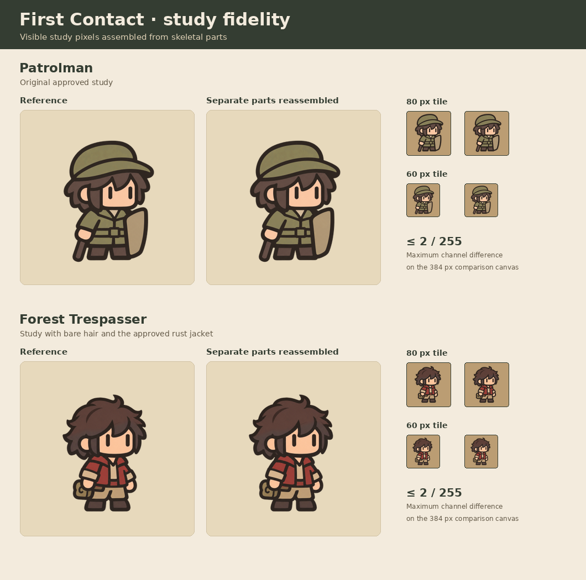

# W27 · First Contact cutout import acceptance

**23 November 2026 · art/w27-first-contact · Godot 4.7.2.stable.official.ed1daf0bf.** The owner approved the study-matched artwork and requested a stronger red accent for enemy units. The revised masters separate the original study's visible pixels into cutouts and add joint fill behind those visible regions. Patrolman uses the approved study throughout. Forest Trespasser retains the study silhouette and receives a muted rust-red jacket and sleeves. The bare-headed edit stays in place. [Study comparison](review/study_comparison.png) · [Articulated cutout sheet](review/cutout_review.png)



## Delivered source and real exports

| Identity | Editable source and exports | Registration |
|---|---|---|
| Patrolman `ranger.patrolman` | [Layered SVG](../../../assets/source-art/rangers/patrolman/patrolman.svg) · [17 RGBA PNGs](../../../assets/imported/rangers/patrolman/) · [manifest](../../../assets/source-art/rangers/patrolman/manifest.json) · [7 animation states](../../../assets/source-art/rangers/patrolman/animation_contract.json) | 69.25 units including the original baton overhang. The study was scaled uniformly and registered at its soles. Two separately attached props with measured shield and baton grips. |
| Forest Trespasser `E01` | [Layered SVG](../../../assets/source-art/enemies/e01/e01.svg) · [15 RGBA PNGs](../../../assets/imported/enemies/e01/) · [manifest](../../../assets/source-art/enemies/e01/manifest.json) · [6 animation states](../../../assets/source-art/enemies/e01/animation_contract.json) | 67.25 units above the shared sole registration. An editable rust overlay tints jacket cloth and the corresponding hidden fills. Alpha, pivots, masks for the 15 parts and animation timing retain their existing values. Independent hip pouch and near-fist accent socket. |
| Scout Sniper `ranger.scout_sniper` | [Existing 19-part manifest](../../../assets/source-art/rangers/scout_sniper/manifest.json) · [C07 rig](../../../scenes/units/scout_rig.tscn) | Reference identity, source, textures, manifest and scene verified against the prior W27 revision. |
| Logistics Post `facility.logistics_post` | [Existing editable SVG](review/logistics_post/logistics_post.svg) · [four independent alpha exports](review/logistics_post/) · [manifest](review/logistics_post/manifest.json) | Base, supply crate, radio and indicator match their recorded hashes. The review sheet assembles the four layers. |

New masters contain one named editable layer per part. Editable masks assign the visible study pixels to layers. Hidden joint fills supply overlap under moving parts. The SVG embeds one stage-sized RGBA reference. Its reference PNG and original study provenance are recorded in the manifest. Each new cutout carries a source layer ID, crop, pivot in three coordinate spaces, structural parent, independent draw order, dimensions and SHA-256. Pose keys apply only to Godot's presentation bones. The exact state, timing, return, mirror and clock contracts are in the linked JSON. [Rig conventions](RIG_AND_IMPORT.md#files-manifest-and-pivots) · [Concept provenance](GENERATION_RECORD.md)

## Enemy palette

Use muted rust and brick-red clothing or gear accents across enemy artwork as those assets are built. Preserve the study-matched proportions, shading and bare-headed direction. E01 establishes the first palette reference. The overlay tints 2,431 jacket and sleeve pixels while retaining the reference alpha mask. [E01 reference](../../../assets/source-art/enemies/e01/rust_reference.png)

## Observed checks

| Check | Result |
|---|---|
| Original source against exported files | Re-exported every named SVG layer using Inkscape 1.4 and compared existing PNG bytes and metadata. Each of 32 parts is independently transparent with four clear pixels on every crop edge and one connected alpha shape at the visible-alpha threshold. Neutral composites match their layered sources within 1/255 per premultiplied channel. The maximum difference from either 384 × 384 reference, including the approved E01 jacket color, is 2/255 per premultiplied channel. The test compares the separate reassembled PNGs directly with each stored reference. |
| Joint support | The center and complete two-logical-unit disk at all 30 attachment pivots are in opaque pixels in each joined part. In the Godot probe each sampled connected pair sustained center and radial overlap in the import, including neutral, extreme key poses, interpolated poses and mirrors. |
| Imports and geometry | Godot loaded all 32 actual PNGs as lossless textures at their declared dimensions. Each generated `Bone2D` parent, rest transform, `Sprite2D` position, alpha, scale and draw order matched its manifest. Both mirrored roots stayed at the ground anchor. Prop positions matched their grip pins during sampled poses. |
| Animation | **916 neutral and animated samples** across 13 clips, both facings, 60 Hz points and authored keys. Manual stepping kept the pose on a zero delta and advanced correctly on a doubled delta. Loops, hold states and regular/blocked returns passed. The review sheet composites the actual imported textures’ Godot transforms with the exported PNGs. |
| Project smoke and independent regressions | Editor import and headless startup passed in the main project. **2,011 existing checks across 28 runners** passed against C26 merge `8a28739`, including First Contact, combat, progression, Story, Chaos and the Scout rig. |

### Repeat the acceptance runs

Run these from the repository root with Godot 4.7.2, Inkscape 1.4 and Python with Pillow.

```sh
python3 -B tools/export_w27_cutouts.py
python3 -B tools/verify_w27_art.py
python3 -B tools/run_regression.py --logs build/qa/w27
```

Use `--write` on the export tool after an intentional source revision to refresh the hashes, crops and pivot measurements. Preserve the study reference when the requested change concerns only hidden overlap. The verification tool builds throwaway scenes from the existing [W06 scene converter](../../../tools/build_cutout_scene.py) and samples their animation using the [isolated probe](../../../tests/art/w27_cutout_probe.gd). Add `--poses /absolute/path/poses.json` to retain the test's captured transforms.

## Acceptance scope

The 32 parts passed isolated rig import and articulation acceptance. Field and tray binding in First Contact, exact visual registration against the live T01 projection, and landscape Android review remain pending. In the future named-device pass, show Patrolman locked both ways, an E01 turn and two E01 held at once, intact underfoot HP, and the four-layer Post on the valid 2×1 location. Compare 1×, 2× and pause with sound off, then confirm identical mission counts, results and save behavior with the art visible. D-014 production release clearance is recorded separately. [C1-01 art batches](../W27_FIRST_CONTACT_ART.md#delivery-batches-and-acceptance) · [C24 device checklist](../../qa/C24_RELEASE_SIGNOFF.md#device-and-host-matrix)
